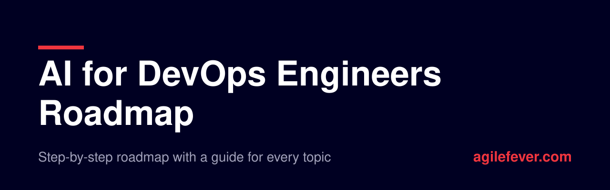

# AI for DevOps Engineers Roadmap

> AI for DevOps Engineers Roadmap - A step-by-step roadmap to automate infrastructure, pipelines, incidents, cost and compliance with Gen AI and Agentic AI, with a blog for every topic

## Table of Contents

- [Who is a DevOps Engineer in the AI Era?](#who-is-a-devops-engineer-in-the-ai-era)
- [How to Use This Roadmap](#how-to-use-this-roadmap)
- [Step 0: Must Know](#step-0-must-know)
- [Step 1: Gen AI Basics for DevOps](#step-1-gen-ai-basics-for-devops)
- [Step 2: Prompt Engineering and Context Engineering](#step-2-prompt-engineering-and-context-engineering)
- [Step 3: Where AI Fits in DevOps](#step-3-where-ai-fits-in-devops)
- [Step 4: Infrastructure as Code Generation](#step-4-infrastructure-as-code-generation)
- [Step 5: CI/CD Pipelines and Container Generation](#step-5-cicd-pipelines-and-container-generation)
- [Step 6: AI Agents and Tool Use](#step-6-ai-agents-and-tool-use)
- [Step 7: Drift Detection and Incident Remediation Agents](#step-7-drift-detection-and-incident-remediation-agents)
- [Step 8: Cloud Cost Optimization Agents](#step-8-cloud-cost-optimization-agents)
- [Step 9: Security and Compliance Automation](#step-9-security-and-compliance-automation)
- [Step 10: Connecting Agents to Your Monitoring Stack](#step-10-connecting-agents-to-your-monitoring-stack)
- [Step 11: Build and Deploy a DevOps Automation Project](#step-11-build-and-deploy-a-devops-automation-project)
- [Step 12: Career Path Toward AI Infrastructure](#step-12-career-path-toward-ai-infrastructure)
- [Step 13: Certification and Next Steps](#step-13-certification-and-next-steps)
- [Learn This Roadmap with a Mentor](#learn-this-roadmap-with-a-mentor)
- [License](#license)

### Prepared and maintained by [AgileFever](https://agilefever.com)

### Follow AgileFever

- [LinkedIn](https://www.linkedin.com/company/agilefever/)
- [YouTube](https://www.youtube.com/@AgileFever)
- [X/Twitter](https://x.com/agilefever)
- [Website](https://agilefever.com)

## Learn with AgileFever

- [Gen AI and Agentic AI for DevOps Engineers](https://agilefever.com/generative-ai/gen-ai-agentic-ai-for-devops-engineer/)

---

> **Note: We keep updating this roadmap with new topics and blogs.**

---

### Who is a DevOps Engineer in the AI Era?

A DevOps engineer builds and runs the systems that ship software: infrastructure, pipelines, containers, monitoring and on-call. Much of this work is scripting and repeated operations, which is where AI helps most.

In simple words, a DevOps engineer who works well with AI is:

- **A faster builder:** generates Terraform, Dockerfiles and pipelines, then validates them before they merge.
- **An agent owner:** runs agents for drift detection, incident response, cost review and compliance, with clear approval gates.
- **A safe operator:** limits what an agent may change, keeps an audit trail, and checks every automated fix.

The order of this roadmap is the order we trust AI with more: first it writes code for us, then it watches and fixes with limits.

### How to Use This Roadmap

This roadmap is for people who already work in the role and want to use AI well in it. No machine learning background is needed.

- Follow the steps in order. Each step builds on the one before it.
- Inside each step, read the blogs in the given order. Every blog explains one idea in plain words.
- Topics without a link are practice areas. Try them on your own work, using any AI assistant you have access to.
- After every step, ask yourself: "Could I use this on my work tomorrow, and check the result before I trust it?" If yes, move on.
- Keep ownership of the output. AI drafts, you decide.

Let's get started.

### Step 0: Must Know

Before the details, learn the words that come up in every AI conversation at work. Each one is a short idea, and the rest of the roadmap builds on them. For DevOps, add one more word: remediation, meaning a fix applied automatically, which needs strict limits.

- [LLM](https://agilefever.com/large-language-models-llm-guide/): the language model behind tools like ChatGPT and Claude
- [Prompt](https://agilefever.com/prompt-engineering-vs-context-engineering/): the instruction and context you give the model
- [Agent](https://agilefever.com/what-is-agentic-ai/): a model that plans steps and uses tools to finish a task
- [MCP](https://agilefever.com/model-context-protocol-explained/): a standard way to connect a model to tools and data
- [Evaluation](https://agilefever.com/evaluate-llm-application/): checking whether an AI output is correct and safe
- [AI glossary from A to Z](https://agilefever.com/artificial-intelligence-terms-ai-glossary-examples/)

### Step 1: Gen AI Basics for DevOps

In this step, we learn what a language model is, what it is good at, and where it fails. Knowing the limits of a model helps you decide which tasks are safe to automate.

- [Large Language Models (LLMs): A Complete Guide](https://agilefever.com/large-language-models-llm-guide/)
- [Agentic AI vs Generative AI: What is the Difference? (2026 Guide)](https://agilefever.com/agentic-ai-vs-generative-ai/)
- [What Is Agentic AI? A Complete Beginner’s Guide (2026)](https://agilefever.com/what-is-agentic-ai/)
- [ChatGPT vs Grok vs Gemini vs Claude vs Perplexity](https://agilefever.com/chatgpt-vs-grok-vs-gemini-vs-claude-vs-perplexity/)
- [Generative AI Courses in 2026: Where to Start with Right One](https://agilefever.com/generative-ai-courses/)

### Step 2: Prompt Engineering and Context Engineering

In this step, we learn to give the model clear instructions and the right context. For DevOps, context means your cloud setup, naming rules and security policy.

- [Prompt Engineering vs Context Engineering: What Changes in Practice](https://agilefever.com/prompt-engineering-vs-context-engineering/)
- Giving the model your own examples, standards and templates
- Asking for a format you can check, such as a table or a checklist
- Splitting a large task into small prompts and reviewing each result

### Step 3: Where AI Fits in DevOps

In this step, we map the pipeline and operations tasks AI handles today, and where a human must stay in the loop.

- [Generative AI in DevOps: 8 Pipeline Tasks AI Handles Today](https://agilefever.com/generative-ai-in-devops/)
- [GenAI & Agentic AI Skills Every DevOps Engineer Needs in 2026](https://agilefever.com/genai-agentic-ai-skills-for-devops-engineers/)
- [GenAI & Agentic AI Use Cases for DevOps Engineers](https://agilefever.com/genai-agentic-ai-use-cases-devops-engineers/)
- [AI Training for DevOps Teams: What to Teach First, Second and Last](https://agilefever.com/ai-training-for-devops-teams/)
- [AI Tools for Software Teams: Where AI Helps in Coding, Testing, Docs and Ops](https://agilefever.com/ai-tools-for-software-teams/)
- [GenAI & Agentic AI for DevOps Engineers: The Complete Guide](https://agilefever.com/genai-agentic-ai-devops-engineers-complete-guide/)

### Step 4: Infrastructure as Code Generation

In this step, we turn infrastructure requirements into Terraform that follows security practice. We always format, validate and review before it goes to a repository.

- Requirements to Terraform: main, variables and outputs
- Encryption, IAM and monitoring defaults
- Running terraform fmt and validate on generated code
- Reviewing security impact before merging
- Adapting output to AWS, Google Cloud or Azure

### Step 5: CI/CD Pipelines and Container Generation

In this step, we generate pipelines and Dockerfiles for a real stack and check that each stage works.

- Pipeline YAML for GitHub Actions, GitLab CI or Jenkins
- Build, test, security scan and deploy stages
- Approval gates, notifications and rollback
- Multi-stage Dockerfiles with health checks and non-root users
- Layer optimization for faster builds
- [SAFe DevOps compared with DevOps Foundation](https://agilefever.com/safe-devops-vs-devops-foundation/)

### Step 6: AI Agents and Tool Use

In this step, we learn how a model goes from answering questions to doing multi-step work with tools. For DevOps, an agent can read cloud state and alerts, run runbooks and report back.

- [What Is Agentic AI? A Complete Beginner’s Guide (2026)](https://agilefever.com/what-is-agentic-ai/)
- [Agentic AI Architecture Explained: Planner, Memory, Tools, and Reflection](https://agilefever.com/agentic-ai-architecture-planner-memory-tools-reflection/)
- [Single-Agent vs Multi-Agent Systems: What’s the Difference? (2026 Guide)](https://agilefever.com/single-agent-system-vs-multi-agent-system/)
- [Model Context Protocol (MCP) Explained for Developers](https://agilefever.com/model-context-protocol-explained/)
- [AI Agent Frameworks Compared: LangGraph, CrewAI and AutoGen](https://agilefever.com/ai-agent-frameworks-compared/)
- [How To Start Learning AI Agents](https://agilefever.com/how-to-start-learning-ai-agents/)

### Step 7: Drift Detection and Incident Remediation Agents

In this step, we build agents that compare cloud state with the Terraform code and respond to alerts using safe runbooks.

- Drift detection: cloud state against desired state
- Generating remediation code with approvals
- Alert ingestion and root cause diagnosis
- Safe runbooks: restart, scale, validate
- Reporting to Slack and PagerDuty

### Step 8: Cloud Cost Optimization Agents

In this step, we use an agent to read billing data, find waste and recommend changes, applying only the low-risk ones.

- Reading billing data and usage patterns
- Finding unused and over-provisioned resources
- Right-sizing, reserved capacity and spot recommendations
- Estimating return per recommendation
- Budget alerts and a cost dashboard

### Step 9: Security and Compliance Automation

In this step, we automate checks for exposed secrets, permissive IAM and known vulnerabilities, with approval gates before fixes.

- Compliance checks against CIS benchmarks
- Secret scanning in env vars and configs
- IAM review
- Container image and dependency scanning
- Remediation approval gates
- [Prompt injection and guardrails for AI agents](https://agilefever.com/prompt-injection-guardrails/)

### Step 10: Connecting Agents to Your Monitoring Stack

In this step, we connect agents to alerts, tickets and chat, and design multi-agent flows with clear ownership.

- Alert to agent triggers
- Metrics from your monitoring tools
- Tickets in Jira and escalation in PagerDuty
- Status updates in Slack
- Who can approve risky changes
- Audit trail of every agent action
- [Model Context Protocol explained](https://agilefever.com/model-context-protocol-explained/)

### Step 11: Build and Deploy a DevOps Automation Project

In this step, we combine what we learned into one project that solves a real operational pain point with at least two agents.

- Incident response automation project
- Infrastructure audit and remediation project
- Cost optimization pipeline project
- Testing in staging before production
- Measuring impact: incidents resolved, cost saved, drift found

### Step 12: Career Path Toward AI Infrastructure

In this step, we look at how DevOps skills carry over into MLOps and LLMOps work.

- [DevOps Engineer to AI Infrastructure Engineer: A Career Transition Roadmap](https://agilefever.com/devops-engineer-to-ai-infrastructure-engineer-roadmap/)
- [Is the MLOps BootCamp Right for DevOps Engineers Moving Into AI?](https://agilefever.com/mlops-bootcamp-for-devops-engineers/)
- [LLMOps vs MLOps: The Complete 2026 Guide](https://agilefever.com/llmops-vs-mlops/)
- [MLOps career guide: roadmap and skills](https://agilefever.com/mlops-career-roadmap-skills-salary/)
- [Forward Deployed Engineer vs DevOps Engineer: Key Differences](https://agilefever.com/forward-deployed-engineer-vs-devops-engineer/)

### Step 13: Certification and Next Steps

In this last step, we check what we have learned and decide how to prove it. Finish the project from Step 11 on a staging environment and write up the measured result.

- [Is GenAI & Agentic AI for DevOps Engineers Worth It?](https://agilefever.com/is-genai-agentic-ai-for-devops-engineers-worth-it/)
- [Course guide: Gen AI and Agentic AI for DevOps Engineers](https://agilefever.com/genai-agentic-ai-devops-engineers-complete-guide/)
- [SAFe DevOps Practitioner certification: syllabus and exam](https://agilefever.com/safe-devops-certification/)

### Learn This Roadmap with a Mentor

If you want to learn this with live coding and labs on your own stack, AgileFever teaches it in [Gen AI and Agentic AI for DevOps Engineers](https://agilefever.com/generative-ai/gen-ai-agentic-ai-for-devops-engineer/). The page lists the modules and current batches.

### License

This roadmap is licensed under CC BY 4.0. You may share and adapt it with credit to AgileFever.
